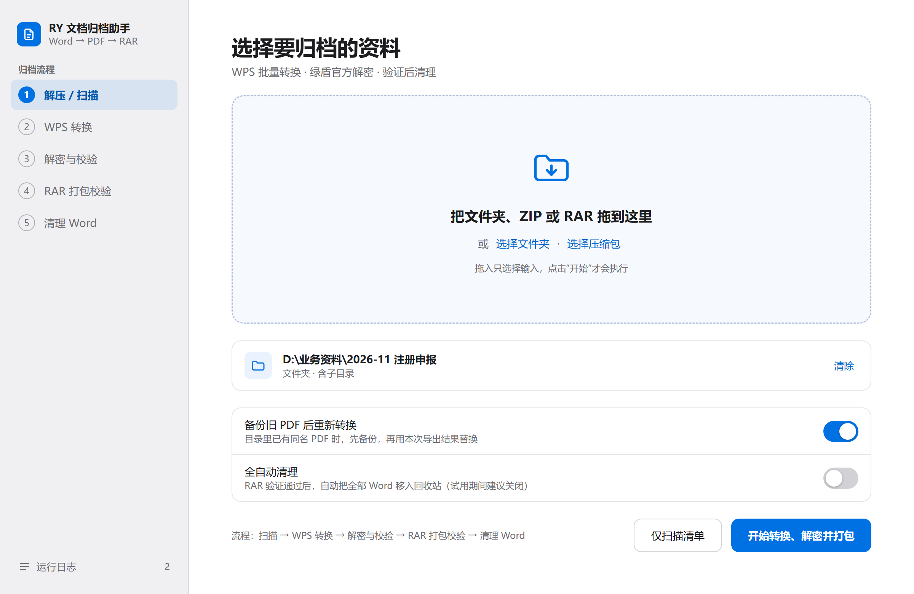
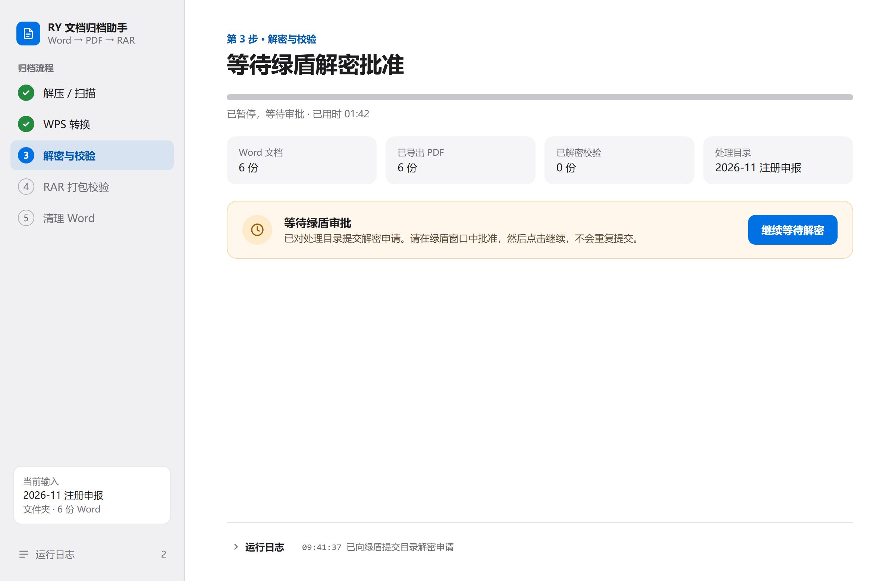
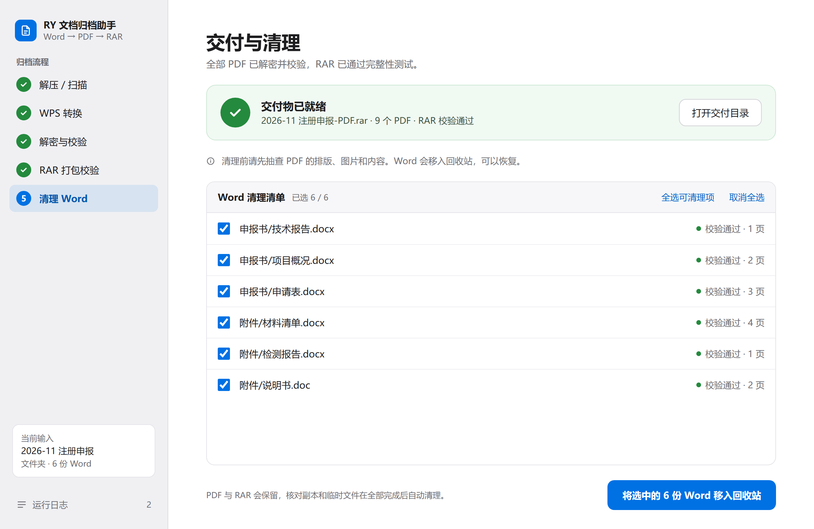

# RY-word2PDF-archiver · 文档归档助手

**同事发来一整包 Word，你需要交出去一包能打开的 PDF。拖进来，点一下，剩下的交给它。**

在装了**绿盾透明加密**的办公电脑上，"Word 转 PDF 再打包发出去"往往不是一件小事：要一份份另存、导出的 PDF 可能仍被加密、对方打不开，还得手动压缩、核对有没有漏文件，最后才敢删掉 Word。这个工具把整个流程串成一条线，每一步都验证过才进入下一步。



---

## 它解决什么问题

| 以前要手动做的 | 现在 |
| --- | --- |
| 一份份打开 Word，另存为 PDF | WPS **只启动一次**，连续批量导出整个文件夹（含子目录） |
| 导出的 PDF 被绿盾自动加密，发出去对方打不开 | 走**绿盾官方申请**对整个目录解密，并逐个确认真的变成明文 |
| 不确定 PDF 有没有导坏、页数对不对 | 逐页解析每个 PDF，**页数必须与原 Word 一致** |
| 手动压缩 RAR，担心漏了或多了文件 | 自动打包 RAR5，解压后与每个 PDF **逐一比对哈希** |
| 删 Word 怕删错、删早 | 交付物全部验证通过后才允许清理，Word 进**回收站**，可恢复 |
| 收到的是 ZIP / RAR，还得先解压 | 直接拖压缩包进来，自动解压到旁边，原包保留 |

一句话：**输入一个文件夹或压缩包，输出一个 `原名称-PDF.rar`，中间所有检查自动完成，任何一步不通过就停下来，不会带病往下走。**

### 适合谁

- 公司电脑装了绿盾透明加密，需要把 Word 资料对外交付成 PDF 的人；
- 经常处理整批文档（申报材料、注册资料、项目附件）的人；
- 想要"批量、快、免费"，又不放心让工具自动删文件的人。

### 不适合

- 没有安装 WPS、绿盾常驻解密程序或 WinRAR 的电脑（见下方"运行环境"）；
- 需要绕过组织审批的场景——本工具只走官方申请流程，审批权限不变。

---

## 界面：三步，一屏只做一件事

左侧始终显示五步进度：**解压/扫描 → WPS 转换 → 解密与校验 → RAR 打包校验 → 清理 Word**。

| ① 开始 | ② 处理中 | ③ 交付与清理 |
| --- | --- | --- |
|  |  |  |
| 拖入文件夹 / ZIP / RAR，选好选项，点开始 | 实时进度；绿盾需要审批时暂停，批准后点"继续等待解密" | RAR 就绪，一键打开交付目录；抽查 PDF 后勾选并清理 Word |

> 拖入只是选择输入，点击"开始转换、解密并打包"才会执行。任务运行中关闭窗口会被拦下，需先停止。

---

## 快速开始

**当前是 2.0 源码试用版，暂不提供新版 EXE。**

```powershell
python -m pip install -r requirements.txt
```

装好依赖后，双击 **`启动程序.vbs`** 打开界面；如果没反应，双击 **`start.bat`** 查看错误。也可以直接运行：

```powershell
python "WPS转PDF神器.py"
```

### 运行环境

- Windows 10/11，Python 3.10+，系统自带的 Microsoft Edge WebView2（界面在原生窗口里渲染，**不会打开 Chrome 或任何浏览器**）。
- **WPS Office**：当前用户能正常打开和导出这些文档。
- **绿盾常驻解密程序** `LdDecryptHotkey.exe`：提供 `GreenShieldQuickApply.Mcp.v1` 本地接口（已与本机服务 1.4.1 联调）。
- **WinRAR**：需要 `Rar.exe`，会从注册表自动查找，无需加入 PATH。

旧版 Tkinter 界面保留为备用：`python "WPS转PDF神器.py" --classic`；缺少 pywebview 时会自动退回旧界面。

---

## 使用步骤

1. **拖入**一个文件夹、ZIP 或 RAR，或点"选择文件夹 / 选择压缩包"。可以先点"仅扫描清单"看看有多少份。
   压缩包会在旁边建一个独立的解压目录，完整解压、检查后再继续，原压缩包保留。支持子文件夹、中文和空格名称。
2. 点 **"开始转换、解密并打包"**。目录里已有同名 PDF 时默认停止；确需重新导出，打开"备份旧 PDF 后重新转换"。
3. 如果绿盾弹出审批，按组织流程处理。两分钟内没完成解密，界面会暂停；批准后点 **"继续等待解密"**，不会重复提交申请。
4. RAR 验证通过后，**先抽查几份 PDF** 的排版、图片和内容。
5. 在清理清单里全选或逐个勾选，点 **"将选中的 N 份 Word 移入回收站"**。全部处理完后，中间文件自动清理。

熟悉并确认稳定后，可以打开 **"全自动清理"**：所有检查通过后自动把本次 Word 移入回收站。试用期间建议保持关闭。

---

## 为什么清理放在最后

流程是 **扫描 → WPS 转换 → 官方解密与 PDF 校验 → RAR 打包校验 → 清理 Word**。

WPS 导出没报错，不代表 PDF 能交付——它可能仍被绿盾加密。所以先解密、校验、打包并验证 RAR，**手里已经有一份验证过的交付物，才动源文件**。

## 每一步自动检查什么

| 环节 | 检查与异常行为 |
| --- | --- |
| 扫描 | `.doc`、`.docx`、`.wps`；忽略 `~$` 临时文件；无法访问、链接/联接点、同名源文件冲突时停止 |
| 转换 | 通过 `KWPS.Application` 后台运行本机 WPS。整批复用一个会话，逐份只读打开、取页数并导出，完成后退出该会话；单份卡住 180 秒时停止 |
| 已有 PDF | 不会默默跳过。明确允许重转时，先备份旧 PDF，再用本次结果替换 |
| 源文件一致性 | 扫描时保存核对副本。WPS 可能让绿盾重新加密源 Word，因此解密后比较副本与源文件内容；不一致就停止 |
| 绿盾 | 对处理目录整体申请解密（不逐文件申请），递归复核数量、加密头和可读性，再实际解析 PDF |
| PDF | 检查文件头和尾部，解析每页内容流，新导出的 PDF 页数必须与源 Word 一致。能直接打开的权限受限 PDF 照常校验，需要打开密码或无法读取时停止 |
| RAR | 真正的 RAR5；完整性测试、文件清单核对、临时解压后与全部 PDF 的 SHA-256 比较 |
| 清理 | 再次确认源文件、全部 PDF、文件清单和 RAR 未变化；逐项移入回收站；中途失败立即停止并记录 |

PDF 解析使用 [pypdf PdfReader](https://pypdf.readthedocs.io/en/6.7.5/modules/PdfReader.html)。排版、图片和文字内容由清理前的人工抽查确认。

**任何失败都不会自动放行下一步。** 中途停止不会撤销已提交的绿盾申请，也不会撤销已完成的转换或清理。

---

## 交付物与任务记录

- **最终结果**：RAR 生成在所选目录旁边，名为 `原名称-PDF.rar`，不带时间戳和随机码；重名时只加 `(2)`、`(3)`，不覆盖已有结果。
- **包内内容**：目录内全部 PDF（包括原先已有的），保留子目录结构；不收录 Word、日志和其他附件。其他类型文件不删除、不打包。
- **中间文件**：核对副本、旧 PDF 备份、转换临时文件和日志在运行期间放在 `%LOCALAPPDATA%/WPSPDFWorkflow/jobs/`，任务完整完成后自动删除；等待确认或失败的任务会保留，方便排查（出错时界面上有"打开任务记录"）。
- **压缩包输入**：任务完成后删除本次解压目录，原压缩包和最终 RAR 保留。
- 自动清理前会再次核对最终 RAR 和原包未变化，拒绝清理原始目录、链接或含用户新增文件的解压目录。

## 已验证与限制

已用本机真实 WPS、绿盾 1.4.1、WinRAR 和 Windows 回收站完成样本联调：两份 Word（两页 / 一页）加一份已有 PDF，三个 PDF 全部解密、校验并归档，两个生成样本完成回收站清理，没有动用户的业务文件。


- 不强杀 WPS。若 WPS 里已有其他打开的文档，会停止并提示先保存关闭。
- 权限、审批或回收站操作失败时直接停止，**不会降级为永久删除**。
- 每次处理一个输入；暂不支持带密码的压缩包、分卷包和嵌套压缩包（可先手动解压，再拖入文件夹）。
- 文件夹扫描最多 10,000 个文件；解压限制 10,000 条目、20 GB。
- 暂停等待审批的任务可在当前窗口继续；关闭窗口后不会自动恢复。

## 绿盾怎么接入、怎么确认解密完成

程序通过当前用户的命名管道 `GreenShieldQuickApply.Mcp.v1`，向已运行的 `LdDecryptHotkey.exe` 发送 JSON 请求，走已安装绿盾的官方申请流程，审批和权限不变。桌面程序可以独立运行，不依赖 Codex 在线。

调用顺序：`status`（服务就绪）→ `check`（递归检查）→ 必要时 `request`（目录申请）→ `wait`（等待，不重复申请）→ 再次 `check`。

只有已知加密头 `87 7D 1C ?? 90 10 29 01` 消失、不可读和警告均为零、扫描数量与完整清单一致时，才校验 PDF 内容流和页数。**仅仅点了申请、申请已提交或等待时间到了，都不算成功。**

---

## 项目结构与开发

前后端分离，后端流程与界面无关：

| 位置 | 作用 |
| --- | --- |
| `web/` | 前端：纯 HTML / CSS / JS，无需构建 |
| `web_app.py` | pywebview 窗口（Edge WebView2）、文件选择、拖放与 JS 接口 |
| `app_controller.py` | 与界面无关的调度层，向前端推送状态快照 |
| `pdf_workflow.py` | 扫描、转换、解密、校验、打包、清理主流程 |
| `archive_input.py` | ZIP / RAR 输入的安全解压 |
| `local_services.py` | 绿盾、WinRAR、回收站 |
| `wps_worker.py` | WPS 转换子进程 |
| `desktop_app.py` | 旧版 Tkinter 界面（`--classic`） |

```powershell
python -m unittest discover -s tests -v
```

- `tests/web_smoke.py`：真实打开一次 WebView2 窗口，检查前端与 Python 接口连通，不调用 WPS 和绿盾。
- `tests/local_smoke.py`：显式运行的本机联调脚本（需额外安装 `python-docx`），只处理自己生成的样本，可能出现官方审批窗口。
- 在普通浏览器预览界面各状态：在 `web/` 目录运行 `python -m http.server`，打开 `index.html?demo=start`（可换成 `process`、`waiting`、`error`、`review`）。

MIT License · [原项目](https://github.com/jedliuai/wps-batch-pdf-converter)
